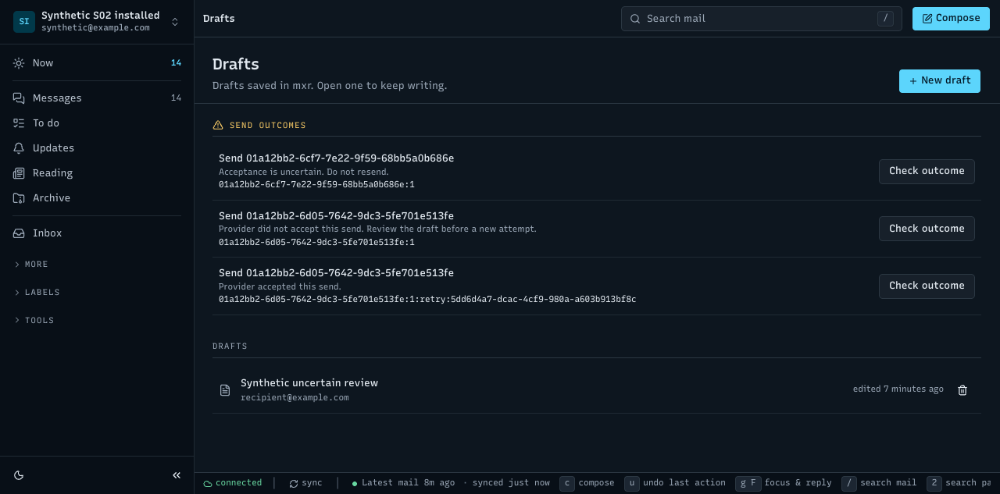

# Published v0.6.68 browser acceptance

The installed v0.6.68 browser journey passed in 8m39s against a fake-only profile. Root accepted the run after checking read-only SQLite outcomes, persistent fake spool records, the scoped localStorage key across restart, the restarted Drafts screen, and port cleanup. The binary SHA-256 is `51a89aec14f4b9c3fae384c567f825e2fd575239f9a34369ee1cfb5259c860ee`; source is `621e9e49739eeb80abbccea0916578420941c3fc`.

A remained Unknown after reload and explicit query, and another send was refused. B's definite rejection preserved its draft; an explicit retry used a distinct operation and was accepted. The final persisted fake spool count was two. The corrected observer record contains three distinct send entries with statuses 502, 502 and 200: A's ambiguous attempt, B's rejection and B's explicit retry. These are deduplicated observer event indexes, not server request IDs.

`storage-key-during-uncertain.json` was captured after the fake accepted record existed and before the timeout response. It proves retention before acknowledgement only, not before the provider effect. The intermediate count sequence was observed in the run transcript; only the final count is durably recorded here with source spool records and root's SQLite query. No request bodies, auth headers, complete browser storage or HAR are included. Browser errors output was empty; three UDS warnings remain unclassified.

`06-restarted-drafts.png` is the selected actual screenshot after the browser and daemon restarted. The copied manifest, count evidence, deduplicated observer metadata and scoped-key files preserve the useful receipts. `selection-provenance.json` records hashes for all 14 source files and identifies the six copied source records plus screenshot; the remaining five screenshots were not needed. The broader acceptance/runtime summaries were omitted where the bounded results are already stated here.

